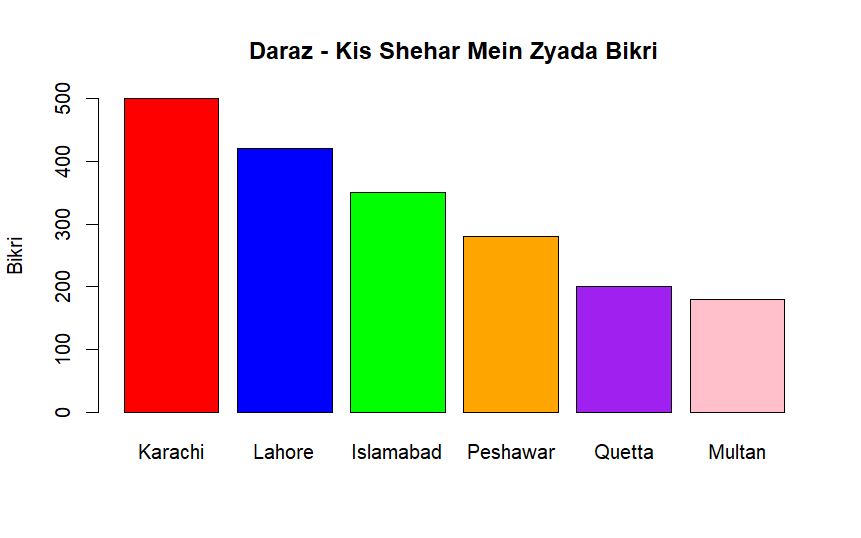
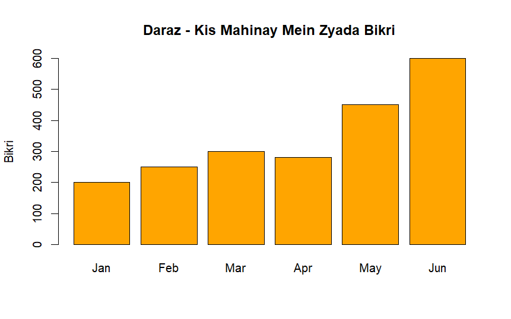
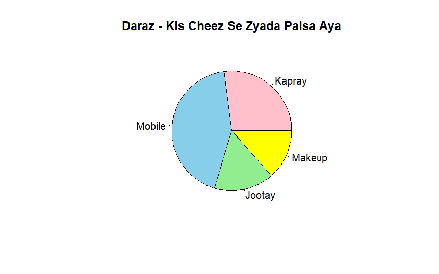

# Daraz Sales Analysis Project

Welcome to my Daraz Sales Project! This is my big project in R.

## What is this project about?
In this project, I analyzed Daraz sales data to find out:
1. Which city has the highest sales?
2. Which month has the highest sales?
3. Which product gives the most profit?

## Tools Used
- R Language
- RStudio
- GitHub

## Graphs in this Project

### 1. Sales by City

Karachi has the highest sales. This shows most customers are from Karachi.

### 2. Sales by Month

June has the highest sales. This shows sales increase in summer.

### 3. Profit by Product

Mobile gives the highest profit. This shows mobile is the most profitable product.

## Key Findings
- Karachi is the top city for Daraz sales.
- June is the best month for sales.
- Mobile is the most profitable product.

## Author
Made by Saliha
First Big Data Project
